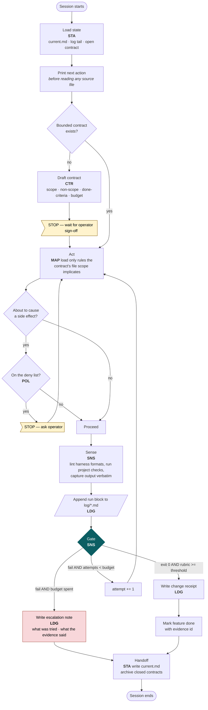
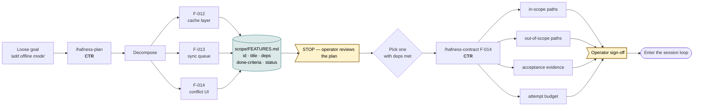
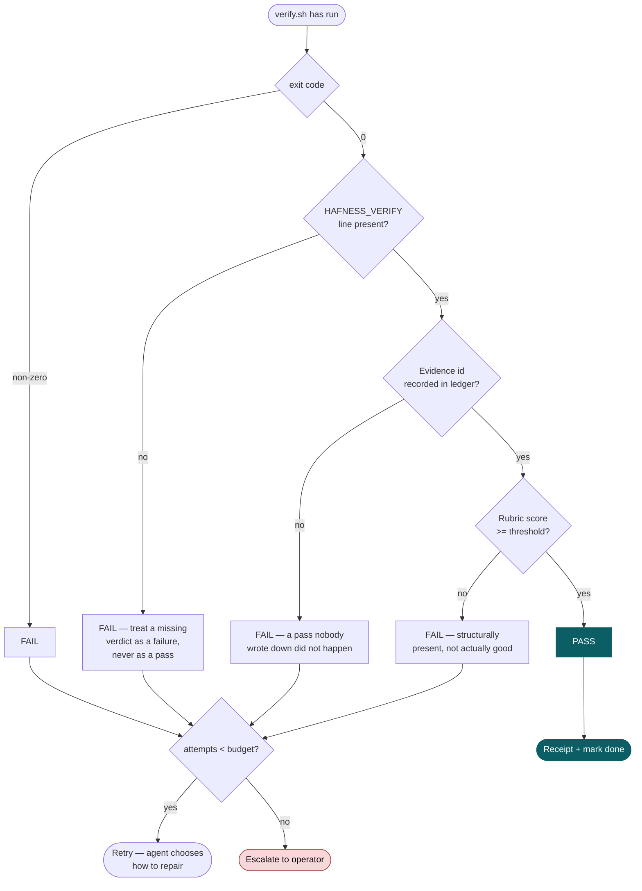
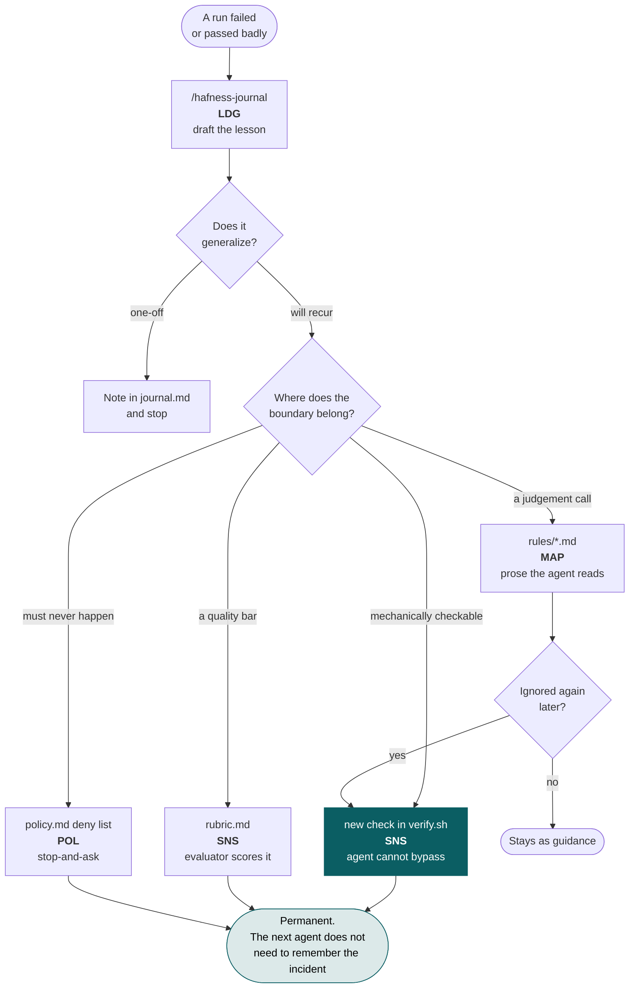
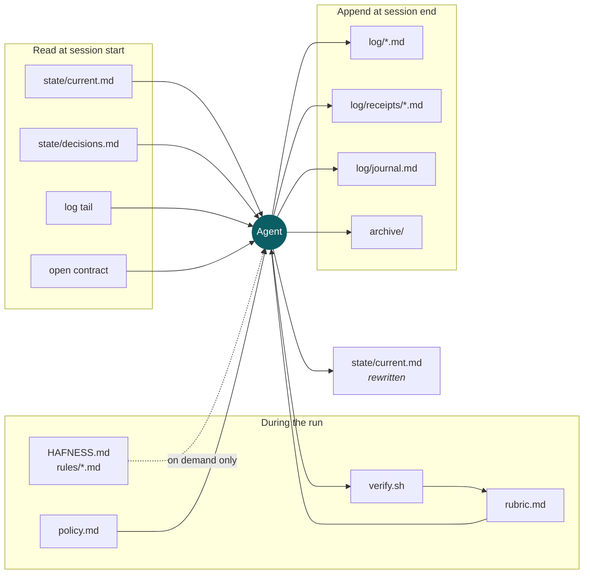
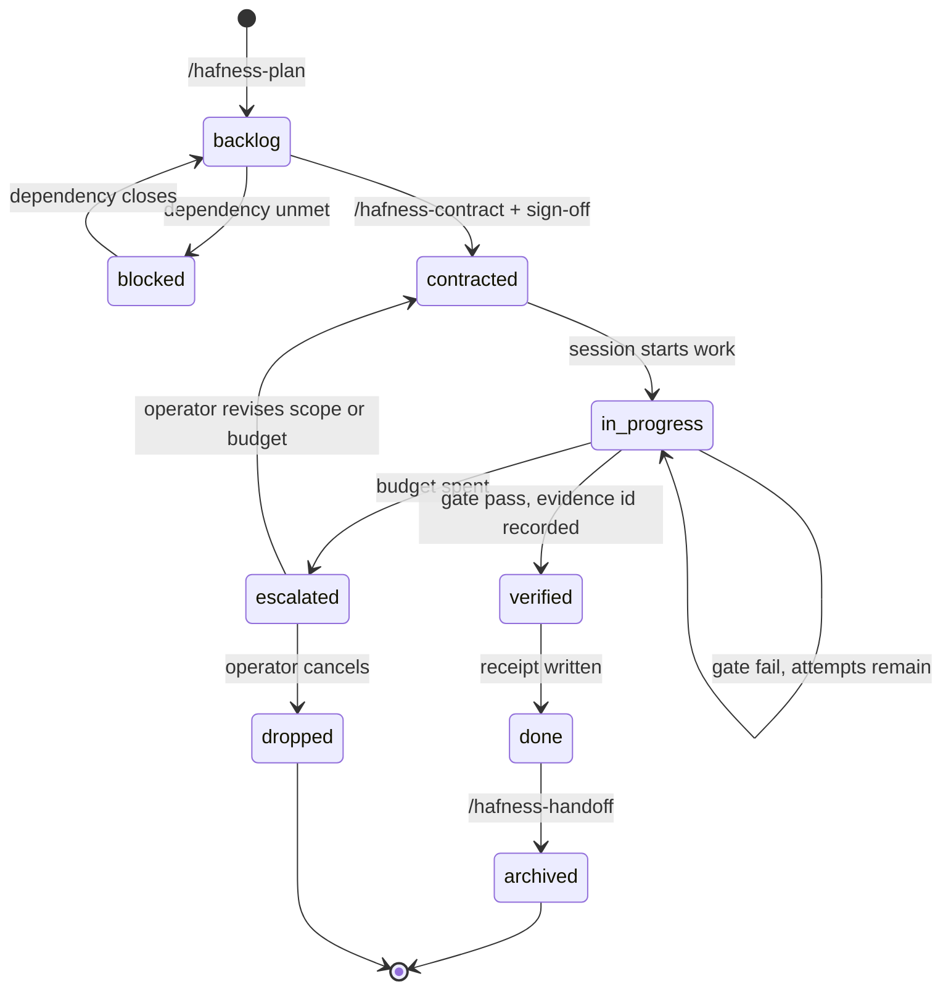

# Hafness — flows

Six diagrams. Together they define what actually happens when Hafness runs, including the
paths most harnesses leave undefined: what happens when the gate fails, and what happens
when the budget runs out.

Subsystem codes: **CTR** Contract · **MAP** Map · **SNS** Sensors · **STA** State · **POL** Policy · **LDG** Ledger

---

## 1. The session loop

The spine. Everything else hangs off this. Note that there are exactly three ways out of the
gate — pass, retry, escalate — and all three write to the ledger. A run never ends silently.

**The important edge is the one most harnesses skip:** `fail AND budget spent`. Without it,
"retry" is the only failure path and the loop runs until you happen to notice.

---

## 2. Task generation

How a loose goal becomes something an agent can be held to. Two separate steps on purpose —
planning produces many features, a contract binds exactly one. Collapsing them is what lets
a task quietly redefine itself mid-run.

Every feature carries a **done-criterion written before the work starts**. A criterion
invented after the fact is just a description of whatever happened.

Two stops, not one. The plan is reviewed as a whole before any feature is picked up, and the
contract is signed off before that feature is worked. `FEATURES.md` is markdown precisely so
the first stop is a real review and not a glance at a JSON blob.

---

## 3. Gate logic

The gate is the single place where "done" is decided, and it is deliberately dumb — it reads
an exit code and a score, not an argument.

Three of the four failure paths exist to close loopholes an agent will otherwise find:
a suppressed exit code, a verdict line that never printed, and work that passes tests
while missing the point.

---

## 4. Failure becomes infrastructure

This is the compounding part. Repairing the output fixes one run; repairing the class
improves every run after it.

The `IGNORED -> CHECK` edge is the rule-promotion path: prose that keeps getting ignored is
evidence that it should have been a script.

---

## 5. Who reads and writes what

The subsystems are separate so that failure is survivable: if the working copy dies the
history survives; if the model changes the policy stays inspectable.

`rules/*.md` is the only dotted edge: it loads **on demand only**, scoped to the files the
contract touches. That dotted line is the difference between a map and a manual.

---

## 6. A feature's lifecycle

Status transitions in the Status column of `FEATURES.md`. There is no edge from `in-progress` straight to
`done` — the only way in is through `verified`, and the only way to `verified` is a recorded
passing run.

`escalated` is a real state, not an error. A run that stops and says what it tried is worth
more than one that keeps going.
